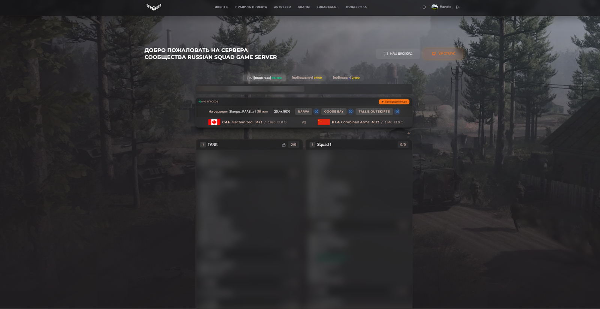
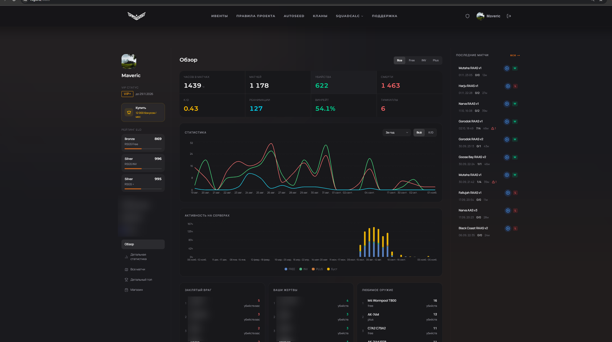
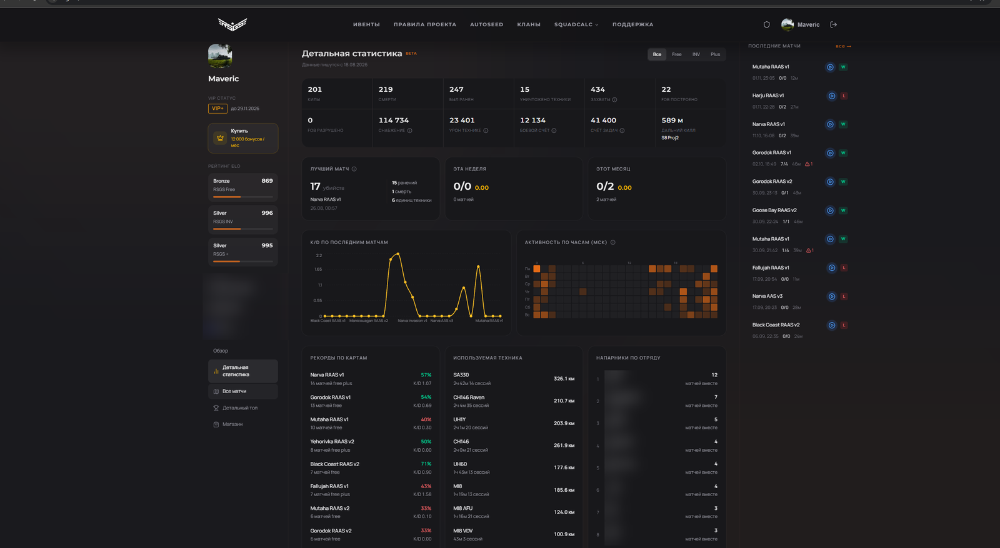
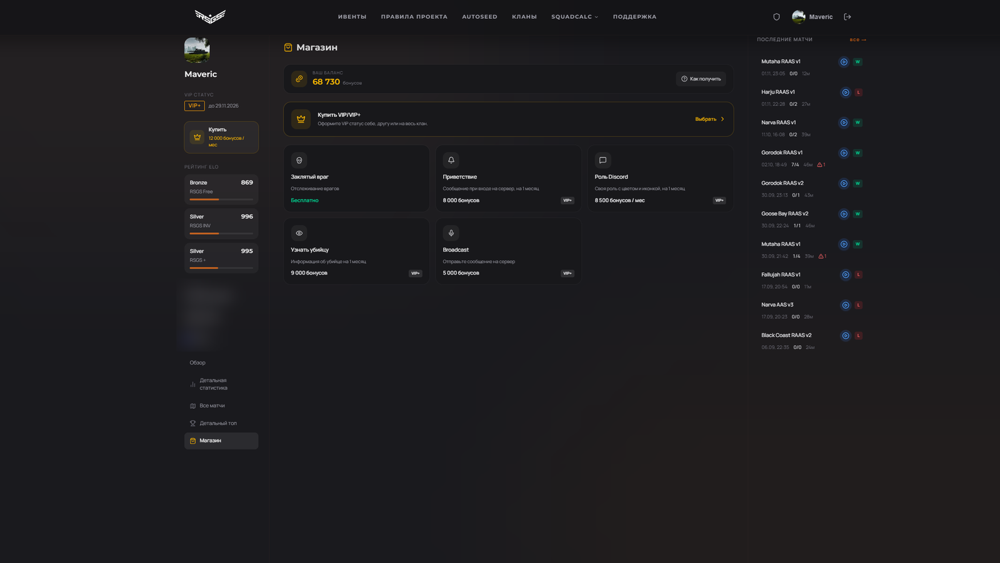
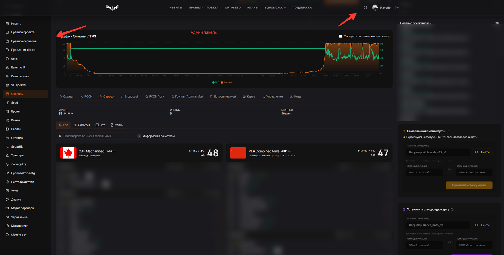

# RSGS — сайт сообщества игрового сервера

Сайт для сообщества Russian Squad Game Server (игра Squad): статистика игроков, онлайн-мониторинг серверов, магазин и админ-панель.
Проект работает в продакшене с 2026 года, им пользуются игроки: **https://rsgs.ru**

## Моя роль

Сайт принадлежит владельцу сообщества, я работал над ним как разработчик с марта 2026 года.
В закрытом репозитории проекта мне принадлежит около 1550 из 1700 коммитов: серверная часть, интерфейс, интеграции с игровыми серверами и админ-панель.
Исходный код закрыт, поэтому здесь только описание и скриншоты.

## Что умеет сайт

**Для игроков**
- Состояние серверов в реальном времени: онлайн, текущая карта, составы команд по отрядам, рейтинг фракций.
- Личный кабинет со статистикой: часы в матчах, убийства и смерти, K/D, реанимации, винрейт, графики по периодам.
- Детальная статистика: рекорды по картам, используемая техника, напарники по отряду, активность по часам, последние матчи.
- ELO-рейтинг отдельно по каждому серверу.
- Магазин: VIP-статус и внутриигровые услуги за внутреннюю валюту.
- Вход через Steam, привязка Discord.

**Для администраторов**
- Мониторинг серверов: график онлайна и TPS, составы команд, события и чат.
- Управление игроками: баны (в том числе по IP и нику), VIP-доступ, права и группы администраторов.
- Управление сервером: RCON, смена карты, очередь карт, broadcast-сообщения, моды.
- История матчей, реплеи, кланы, логи сайта, интеграция с Discord-ботом.

## Стек

- **Backend:** Python, FastAPI, SQLAlchemy (async), Alembic, PostgreSQL, Redis, APScheduler, JWT.
- **Frontend:** Next.js, React, TypeScript, Tailwind CSS, shadcn/ui, TanStack Query и Table, Recharts.
- **Интеграции с игрой:** опрос серверов по протоколу A2S, управление через RCON, разбор логов сервера, вход через Steam OpenID.
- **Боты:** Discord-бот для событий и уведомлений на Node.js.
- **Инфраструктура:** Docker Compose, nginx, Let's Encrypt, мониторинг и резервное копирование, деплой скриптом.

## Скриншоты

Главная: состояние серверов и составы команд.

Личный кабинет игрока: обзор статистики.

Детальная статистика игрока.

Магазин.

Админ-панель.

На скриншотах скрыты идентификаторы игроков и личные данные.
